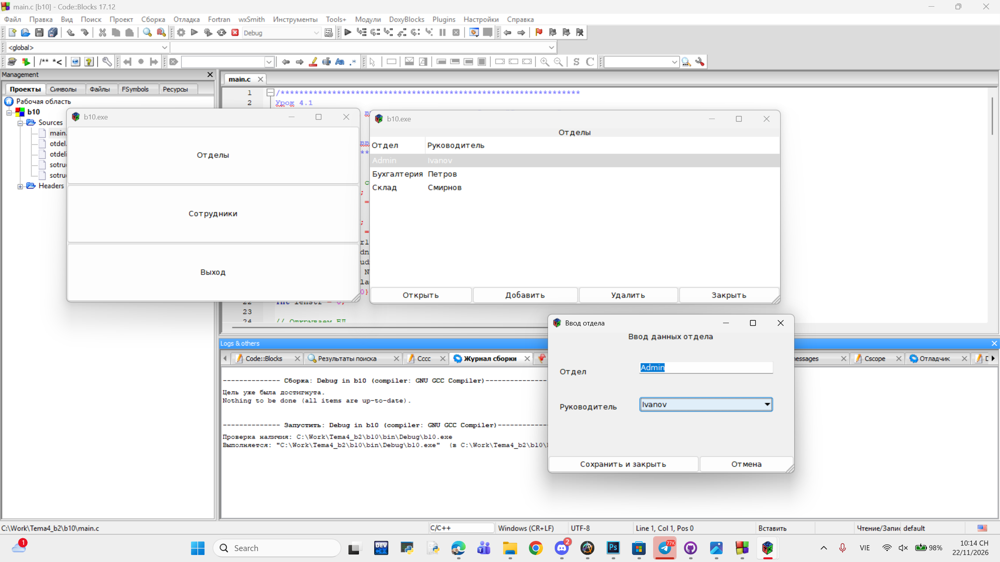
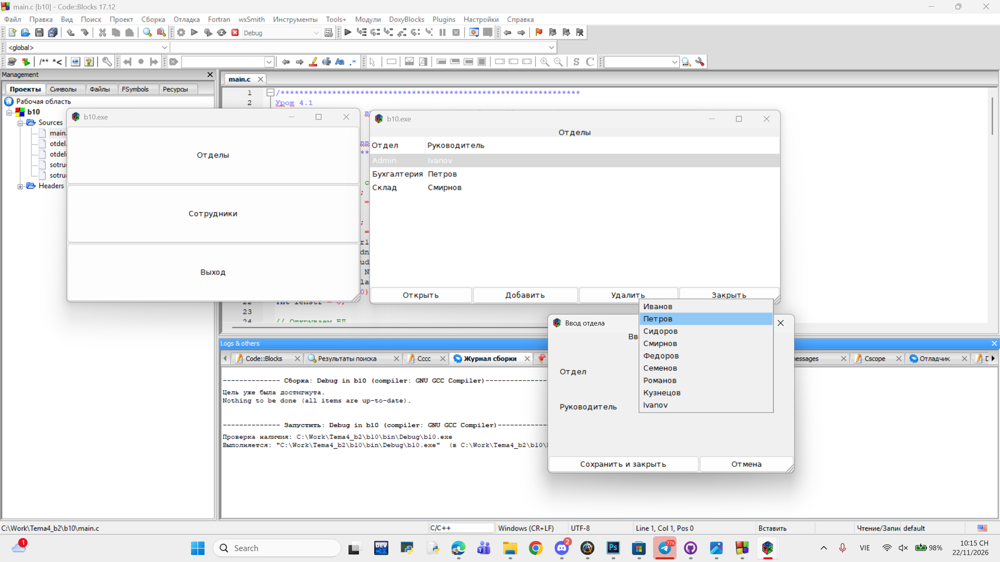
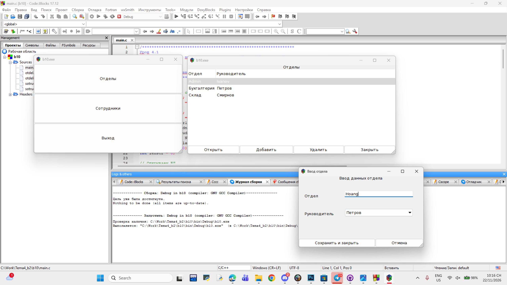
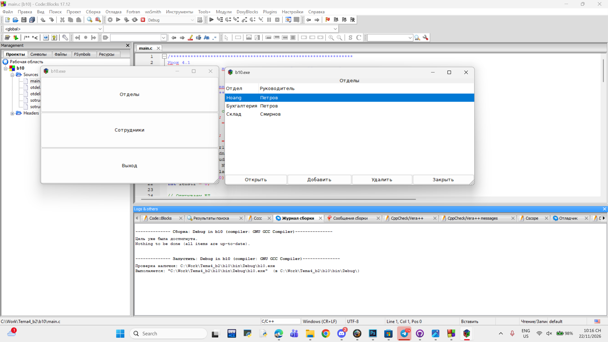

# ОТЧЁТ ПО ПРАКТИЧЕСКОЙ РАБОТЕ — ТЕМА 4, ЗАДАНИЕ 2

**Дисциплина:** Модели управления информационными ресурсами  
**Выполнил:** Нгуен Минь Хоанг  
**Группа:** 2-МГ-29  
**Преподаватель:** Е. Н. Дроздова  
**Среда разработки:** Code::Blocks 17.12, GTK+ 3, Glade, SQLite

## 1. Постановка задания

По материалам `template/Tema_4.pdf`, стр. 18–20, требуется реализовать выбор из списка для таблицы «Отделы». В форме `w_otdel` необходимо добавить `GtkComboBoxText` для поля «Руководитель», загрузить список по полям «Код сотрудника» и «Фамилия» таблицы «Сотрудники», установить текущий выбор по фамилии, а при сохранении записать **текст фамилии**, а не числовой идентификатор. В отчет необходимо включить снимки формы в Glade и Code::Blocks, функции `LoadRecord1()`, `LoadCombobox1()`, `SaveRecord1()`, `ShowOtdel()` и исходный файл `main.h`; изменения относительно первого задания выделяются красным.

## 2. Реализация

Программа использует библиотеку GTK+ 3 для пользовательского интерфейса и SQLite для хранения записей. В файле `bin/Debug/main.glade` поле свободного ввода имени руководителя заменено на `GtkComboBoxText` с ID `comboboxtext2`.

- `LoadRecord1()` читает `Отдел` и `Руководитель` выбранной строки из `Отделы` и сохраняет текущую фамилию в `BossName`.
- `LoadCombobox1()` извлекает фамилии из `Сотрудники` в порядке `Код сотрудника`, заполняет список и находит первоначально выбранную фамилию по текстовому совпадению (а не по формуле `id - 1`).
- `SaveRecord1()` считывает `gtk_combo_box_text_get_active_text()`, проверяет наличие выбранного руководителя и сохраняет фамилию в SQLite через параметризованный `UPDATE`.
- `ShowOtdel()` загружает `main.glade`, подключает `comboboxtext2`, вызывает функции загрузки записи и списка.
- `main.h` содержит декларацию `extern GtkComboBoxText *gBossCombo;`.

### SQL-запросы

```sql
SELECT [Код сотрудника], Фамилия
FROM Сотрудники
WHERE Фамилия IS NOT NULL AND TRIM(Фамилия) <> ''
ORDER BY [Код сотрудника];
```

```sql
SELECT Отдел, Руководитель FROM Отделы WHERE [Код отдела]=?;
UPDATE Отделы SET Отдел=?, Руководитель=? WHERE [Код отдела]=?;
```

## 3. Результаты выполнения

Проверка проводилась студентом в Windows 22.11.2026. По четырем реальным скриншотам подтверждено:
1. Успешный запуск `b10.exe`, открытие списка «Отделы», отображение формы `Ввод отдела` с комбинированным полем «Руководитель».
2. Открытие выпадающего списка фамилий, полученных из базы данных сотрудников.
3. Ввод названия `Hoang` и выбор руководителя `Петров`.
4. После нажатия «Сохранить и закрыть» таблица GTK показывает `Hoang / Петров`.

**Рисунок 1 — Форма изменения отдела:**  


**Рисунок 2 — Выбор руководителя из списка сотрудников:**  


**Рисунок 3 — Ввод измененного отдела и выбранной фамилии:**  


**Рисунок 4 — Результат изменения в таблице отделов:**  


| Проверка | Результат |
|---|---|
| Открытие приложения | Подтверждено |
| Виджет GtkComboBoxText | Подтверждено |
| Загрузка фамилий сотрудников | Подтверждено |
| Выбор «Петров» | Подтверждено |
| Отображение «Hoang / Петров» после сохранения | Подтверждено |
| Проверка сохранения после полного перезапуска | Не предъявлена |
| Снимок экрана формы в редакторе Glade | Не предъявлен |
| Повторная сборка после исправления списка | Ожидает проверки |

**Точечная корректировка исходного кода:** удалено добавление старого значения руководителя (например, `Ivanov`) в список, если такой сотрудник отсутствует в таблице `Сотрудники`. Теперь неподходящее значение не выбирается автоматически; для сохранения требуется фамилия существующего сотрудника. Исправление внесено в исходный код репозитория после получения четырех снимков. Поэтому снимок 2 показывает версию до этой корректировки.

## 4. Листинг программы

Основной исходный код `b10/otdel.c` приведён ниже. Функции, относящиеся к заданию 2, сохранены без сокращений. В итоговом файле Word изменения относительно задания 1 следует отметить красным.

### `int LoadRecord1(int otdel)`

```c
int LoadRecord1(int otdel)
{
    sqlite3_stmt *q = NULL;
    int result;

    result = sqlite3_prepare_v2(db,
        "SELECT Отдел, Руководитель FROM Отделы WHERE [Код отдела]=?",
        -1, &q, NULL);
    if (result != SQLITE_OK) goto fail;
    sqlite3_bind_int(q, 1, otdel);
    result = sqlite3_step(q);
    if (result != SQLITE_ROW) goto fail;

    const unsigned char *department = sqlite3_column_text(q, 0);
    const unsigned char *manager = sqlite3_column_text(q, 1);
    gtk_entry_set_text(gOtdel, department ? (const char *)department : "");
    g_strlcpy(BossName, manager ? (const char *)manager : "", sizeof(BossName));
    sqlite3_finalize(q);
    return 0;

fail:
    g_snprintf(str, sizeof(str), "Ошибка загрузки отдела: %s",
               result == SQLITE_DONE ? "Запись не найдена" : sqlite3_errmsg(db));
    if (q) sqlite3_finalize(q);
    return 1;
}
```

### `int LoadCombobox1(void)`

```c
int LoadCombobox1(void)
{
    sqlite3_stmt *q = NULL;
    int result, index = 0, selected = -1;
    const char *sql = "SELECT [Код сотрудника], Фамилия FROM Сотрудники "
                      "WHERE Фамилия IS NOT NULL AND TRIM(Фамилия) <> '' "
                      "ORDER BY [Код сотрудника]";
    if (!gBossCombo) return 1;
    gtk_combo_box_text_remove_all(gBossCombo);
    result = sqlite3_prepare_v2(db, sql, -1, &q, NULL);
    if (result != SQLITE_OK) goto fail;
    while ((result = sqlite3_step(q)) == SQLITE_ROW) {
        const unsigned char *surname = sqlite3_column_text(q, 1);
        if (!surname) continue;
        gtk_combo_box_text_append_text(gBossCombo, (const char *)surname);
        if (selected < 0 && g_strcmp0((const char *)surname, BossName) == 0)
            selected = index;
        index++;
    }
    if (result != SQLITE_DONE) goto fail;
    sqlite3_finalize(q);
    /* An outdated surname is not an employee: leave selection empty.
       SaveRecord1() requires the user to select a current employee. */
    gtk_combo_box_set_active(GTK_COMBO_BOX(gBossCombo), selected);
    return 0;
fail:
    g_snprintf(str, sizeof(str), "Ошибка загрузки списка руководителей: %s", sqlite3_errmsg(db));
    if (q) sqlite3_finalize(q);
    return 1;
}
```

### `int SaveRecord1(void)`

```c
int SaveRecord1(void)
{
    sqlite3_stmt *q = NULL;
    int result;
    gchar *department = g_strdup(gtk_entry_get_text(gOtdel));
    gchar *manager = gtk_combo_box_text_get_active_text(gBossCombo);
    if (!manager) manager = g_strdup("");
    g_strstrip(department);
    g_strstrip(manager);

    if (!manager[0]) {
        g_snprintf(str, sizeof(str), "Выберите руководителя из списка.");
        g_free(department);
        g_free(manager);
        return 1;
    }
    if (!department[0]) {
        g_snprintf(str, sizeof(str), "Введите наименование отдела.");
        g_free(department);
        g_free(manager);
        return 1;
    }
    result = sqlite3_prepare_v2(db,
        "UPDATE Отделы SET Отдел=?, Руководитель=? WHERE [Код отдела]=?",
        -1, &q, NULL);
    if (result != SQLITE_OK) goto fail;
    sqlite3_bind_text(q, 1, department, -1, SQLITE_TRANSIENT);
    sqlite3_bind_text(q, 2, manager, -1, SQLITE_TRANSIENT);
    sqlite3_bind_int(q, 3, CurOtdel);
    result = sqlite3_step(q);
    if (result != SQLITE_DONE) goto fail;
    sqlite3_finalize(q);
    g_free(department);
    g_free(manager);
    return 0;

fail:
    g_snprintf(str, sizeof(str), "Ошибка сохранения: %s", sqlite3_errmsg(db));
    if (q) sqlite3_finalize(q);
    g_free(department);
    g_free(manager);
    return 1;
}
```

### `void ShowOtdel(int otdel)`

```c
void ShowOtdel(int otdel)
{
    GError *error = NULL;
    CurOtdel = otdel;
    b_otdel = gtk_builder_new();
    if (!gtk_builder_add_from_file(b_otdel, "main.glade", &error)) {
        g_snprintf(str, sizeof(str), "Не удалось открыть main.glade: %s",
                   error ? error->message : "неизвестная ошибка");
        if (error) g_error_free(error);
        ShowError();
        g_object_unref(b_otdel);
        b_otdel = NULL;
        return;
    }
    w_otdel = GTK_WIDGET(gtk_builder_get_object(b_otdel, "w_otdel"));
    gOtdel = GTK_ENTRY(gtk_builder_get_object(b_otdel, "entry_otdel"));
    gBossCombo = GTK_COMBO_BOX_TEXT(gtk_builder_get_object(b_otdel, "comboboxtext2"));
    if (!w_otdel || !gOtdel || !gBossCombo) {
        g_snprintf(str, sizeof(str), "Не найдены виджеты формы w_otdel.");
        ShowError();
        g_object_unref(b_otdel);
        b_otdel = NULL;
        return;
    }
    gtk_window_set_title(GTK_WINDOW(w_otdel), "Ввод отдела");
    gtk_window_set_default_size(GTK_WINDOW(w_otdel), 420, 240);
    gtk_window_set_position(GTK_WINDOW(w_otdel), GTK_WIN_POS_CENTER);
    if (window3) gtk_window_set_transient_for(GTK_WINDOW(w_otdel), GTK_WINDOW(window3));
    gtk_window_set_modal(GTK_WINDOW(w_otdel), TRUE);
    gtk_builder_connect_signals(b_otdel, NULL);
    if (LoadRecord1(otdel)) {
        ShowError();
        gtk_widget_destroy(w_otdel);
        g_object_unref(b_otdel);
        b_otdel = NULL;
        return;
    }
    if (LoadCombobox1()) {
        ShowError();
        gtk_widget_destroy(w_otdel);
        g_object_unref(b_otdel);
        b_otdel = NULL;
        return;
    }
    gtk_widget_show_all(w_otdel);
    /* Builder is retained for the lifetime of this form. */
}
```

### Файл `main.h`

```c
#ifndef MAIN_H_INCLUDED
#define MAIN_H_INCLUDED

#include <stdlib.h>
#include <stdio.h>
#include <string.h>
#include <gtk/gtk.h>
#include <sqlite3.h>
#include "sotrudniki.h"
#include "sotrudnik.h"
#include "otdeli.h"
#include "otdel.h"

/* Shared application state: definitions live in main.c. */
extern sqlite3 *db;
extern sqlite3_stmt *stmt;
extern char *err;
extern int rc;
extern GtkWidget *window1, *window2, *window3;
extern GtkBuilder *builder1, *builder2, *builder3;
extern GtkWidget *w_sotrudnik;
extern GtkBuilder *b_sotrudnik;
extern GtkWidget *gSotr;
extern GtkSpinButton *gOklad;
extern char str[1000];
extern int lenstr;
/* Tema 4, task 2: selector for manager surname. */
extern GtkComboBoxText *gBossCombo;

void StartDB(void);
void EndDB(void);
void ShowError(void);
int ShowSQL(void);

#endif
```

## 5. Вывод

Реализована форма выбора руководителя отдела из списка, загружаемого из SQLite. По представленным снимкам подтверждены открытие списка, выбор фамилии, изменение отдела и отображение результата после сохранения. Проверка долговременного хранения в SQLiteStudio и новый снимок Glade остаются дополнительными шагами для полного комплекта доказательств.
